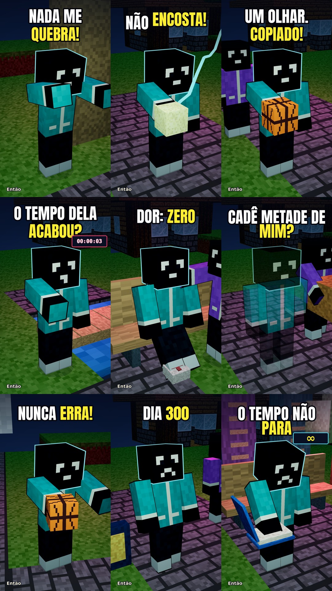

# Nove ideias — 30 segundos cada

Os nove temas do print, em histórias originais com nossos personagens no visual Minecraft clássico. **Todos em vertical 1080×1920, 24 fps e 30 segundos exatos.** Mesma voz Puck, efeitos sintetizados em Python e dois CTAs em vídeo distintos.

| Tema | Vídeo e prévia | Projeto | Capa, título, descrição e tags |
|---|---|---|---|
| Indestrutível | [MP4 + prévia](../../projetos/29-indestrutivel/exports/) | [Fonte e roteiro](../../projetos/29-indestrutivel/) | [YouTube](../../youtube/29%20-%20Indestrut%C3%ADvel%20n%C3%A3o%20significa%20invenc%C3%ADvel/) |
| Controlar eletricidade | [MP4 + prévia](../../projetos/30-controlar-eletricidade/exports/) | [Fonte e roteiro](../../projetos/30-controlar-eletricidade/) | [YouTube](../../youtube/30%20-%20A%20cidade%20ficou%20nas%20m%C3%A3os%20dele/) |
| Copiar habilidades | [MP4 + prévia](../../projetos/31-copiar-habilidades/exports/) | [Fonte e roteiro](../../projetos/31-copiar-habilidades/) | [YouTube](../../youtube/31%20-%20Copiou%20o%20talento.%20Faltou%20uma%20coisa/) |
| Contadores de vida | [MP4 + prévia](../../projetos/32-contadores-de-vida/exports/) | [Fonte e roteiro](../../projetos/32-contadores-de-vida/) | [YouTube](../../youtube/32%20-%20Ele%20enxergou%20o%20tempo%20que%20ningu%C3%A9m%20v%C3%AA/) |
| Não sentir dor | [MP4 + prévia](../../projetos/33-nao-sentir-dor/exports/) | [Fonte e roteiro](../../projetos/33-nao-sentir-dor/) | [YouTube](../../youtube/33%20-%20Sem%20dor%2C%20ele%20perdeu%20o%20aviso/) |
| Invisibilidade | [MP4 + prévia](../../projetos/34-invisibilidade/exports/) | [Fonte e roteiro](../../projetos/34-invisibilidade/) | [YouTube](../../youtube/34%20-%20Ele%20sumiu.%20O%20problema%20ficou/) |
| Nunca errar | [MP4 + prévia](../../projetos/35-nunca-errar/exports/) | [Fonte e roteiro](../../projetos/35-nunca-errar/) | [YouTube](../../youtube/35%20-%20Ele%20acertava%20tudo.%20At%C3%A9%20isso%20acontecer/) |
| Repetir o mesmo dia | [MP4 + prévia](../../projetos/36-mesmo-dia-30/exports/) | [Fonte e roteiro](../../projetos/36-mesmo-dia-30/) | [YouTube](../../youtube/36%20-%20O%20dia%20reiniciava.%20S%C3%B3%20ele%20lembrava/) |
| Imortalidade | [MP4 + prévia](../../projetos/37-imortal-30/exports/) | [Fonte e roteiro](../../projetos/37-imortal-30/) | [YouTube](../../youtube/37%20-%20Ele%20ficou.%20O%20mundo%20continuou/) |

Cada pasta inclui roteiro, cenas, skins/texturas próprias, scripts, áudio e stems, MP4, prévia de 10 segundos e relatórios de validação. Título, descrição e tags ficam juntos no arquivo `YOUTUBE`. Sem upload ao YouTube.

As premissas vieram do print; os roteiros e movimentos são próprios. Não foi alegada análise integral de vídeos ausentes. As histórias são ficção; a distinção entre dor e lesão tem referência em MedlinePlus no projeto 33.

A narração foi conferida por transcrição automática antes da mix. Os MP4s passaram por contagem de quadros, checagem de resolução/áudio e decodificação integral. Quadros das exportações foram inspecionados. Isso não equivale a aprovação estética do usuário nem a audição humana integral.

A segunda chave fornecida pelo usuário gerou a narração nova do 37 após a primeira atingir cota. Mesma voz/modelo; não foi ativado faturamento nem verificado qual plano a chave utiliza.
