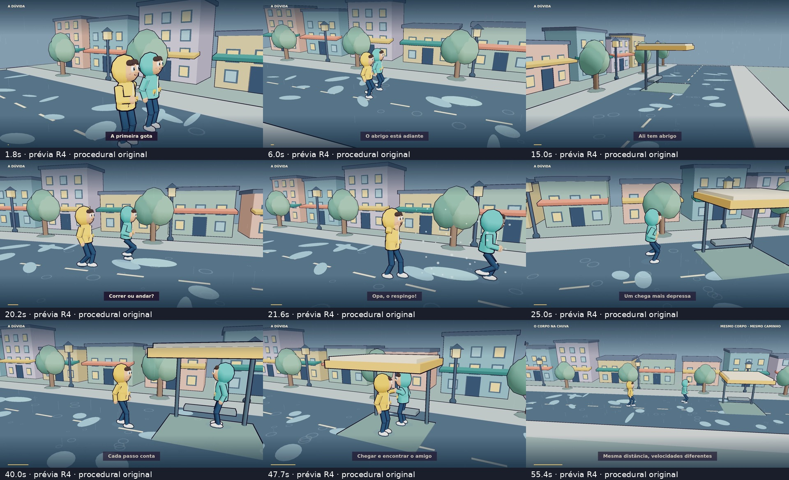

# 01 - Andar ou Correr na chuva

[Prévia atual de 1 minuto em 1080p](../../videos/01%20-%20Andar%20ou%20Correr%20na%20chuva%20-%20Preview%201min.mp4)



A revisão R4 retoma o renderizador procedural **Three.js/Canvas dos primeiros vídeos**, com o mesmo cenário e personagens próprios de casaco amarelo e verde. A nova abertura de 60 segundos tem personagens um pouco mais alongados, braços e pernas de comprimentos fixos, pés apoiados no chão, gestos com preparação e retorno, deslocamento contínuo e cortes escritos para cada ação.

A sequência mostra a primeira gota, a decisão diante da chuva, a caminhada e a corrida até o abrigo, um respingo com reação e o encontro dos personagens. Os movimentos de câmera alternam contexto, ação, reação, acompanhamento, rotação e vista do trajeto. Os contornos continuam sendo geometria 3D; sobrancelhas e pequenas marcas dos casacos também recebem traços curvos calculados por código.

O player contém a abertura R4 e o restante do projeto anterior. O MP4 completo de oito minutos ainda é a versão anterior; esta entrega revisa a prévia de um minuto. O experimento Blender está arquivado em `Animação/Blender`.

A narração Puck tratada foi preservada. O primeiro minuto tem nova chuva, passos, respingo e cumprimento sintetizados em Python. A mixagem do player foi atualizada nesse trecho. O texto sobre programação continua removido da narração.

## Executar

Requisitos: Node 22+, Python 3 com NumPy, Chromium e FFmpeg/FFprobe com libx264.

```sh
npm ci
npm run serve
npm test
```

Abra o servidor local na porta 4175. `CHROMIUM_PATH` permite escolher outro executável Chromium; o padrão é `/usr/bin/chromium`.

## Renderizar a prévia

```sh
python scripts/sound-preview.py --output /tmp/efeitos-preview.wav
python scripts/render-preview.py --output /tmp/chuva-preview-60s.mp4
```

O renderer calcula os quadros a **1920 × 1080, 24 fps**, monta o MP4 com a mixagem e valida duração, dimensões, número de quadros, tamanho e decodificação completa. O parâmetro `--work` escolhe uma pasta para intermediários e logs; `--audio` permite fornecer uma mixagem WAV. A mixagem padrão é `audio/mix.mp3`.

Para renderizar apenas um trecho sem áudio:

```sh
node scripts/render.mjs --start 19 --duration 5 --output /tmp/corrida.mp4
```

## Organização e conferência

- `film.js`: geometria, materiais, personagens, articulações, chuva, gráficos e saída Canvas.
- `opening.js`: trajetos contínuos, gestos e câmeras da abertura de um minuto.
- `kinematics.js`: IK de dois segmentos e interpolação dos gestos em arco.
- `story.js`, `direction.js`, `timing.json`: estrutura do episódio e direção dos demais capítulos.
- `scripts/inspect-locomotion.mjs`: verifica os comprimentos dos segmentos, o apoio dos pés, o deslocamento real e o contato entre as mãos a partir dos personagens efetivamente posados.
- `qa/`: conferência atual R4 e arquivos identificados das revisões anteriores.
- `vendor/three.min.js`: Three.js r128, licença MIT.

Toda a imagem nasce de código: não há imagens prontas, modelos importados, vídeos de fundo ou efeitos sonoros de biblioteca. A voz é sintetizada pelo Gemini. A conferência de áudio é automatizada; não há alegação de escuta humana.
