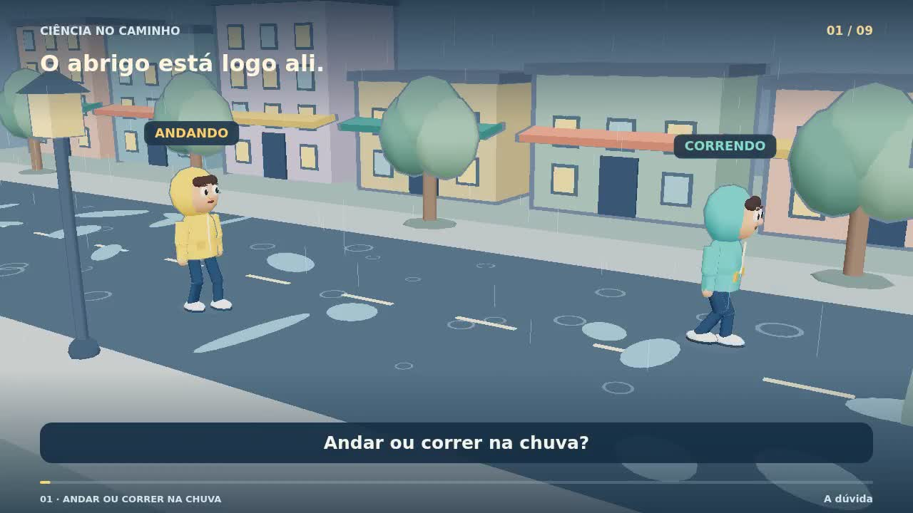

# 01 - Andar ou Correr na chuva



[Prévia de 1 minuto](../../videos/01%20-%20Andar%20ou%20Correr%20na%20chuva%20-%20Preview%201min.mp4) · [Filme completo de 8 minutos](../../videos/01%20-%20Andar%20ou%20Correr%20na%20chuva.mp4)

Animação explicativa de oito minutos, em português, com personagens e cidade 3D construídos por código. Inspirada na linguagem visual de um jogo cartoon procedural: volumes arredondados, contornos, cores quentes nas roupas e cenário de chuva. A montagem alterna enquadramentos a cada seis segundos, com órbitas, aproximações, planos laterais, baixos e de cima, além de diagramas tridimensionais.

## Arquivos

- `index.html`, `film.js`: player, geometria, personagens articulados, chuva, câmera e elementos gráficos.
- `timing.json`: nove capítulos alinhados à narração final.
- `narracao.txt`: texto do vídeo.
- `audio/narracao.mp3`: voz Puck, Gemini 3.8 Flash TTS, com tratamento de volume e pausas.
- `audio/efeitos.mp3`: chuva, vento e passos sintetizados em NumPy.
- `audio/mix.mp3`: mixagem usada na exportação, com efeitos reduzidos durante a voz.
- `scripts/`: servidor, renderização determinística, síntese de som e validação.
- `qa/`: relatórios técnicos e quadros de revisão.
- `vendor/three.min.js`: Three.js r128, licença MIT.

Nenhuma imagem pronta, modelo 3D importado, vídeo de fundo ou efeito sonoro de biblioteca participa do renderizador. As imagens do filme são frames calculados pelo código; os textos são desenhados como gráficos vetoriais. A voz é sintetizada pelo Gemini, não por síntese local.

## Executar

Requisitos: Node 22+, Python 3 com NumPy, Chromium e FFmpeg/FFprobe com libx264.

```sh
npm ci
npm run serve
# Abra o servidor no seu ambiente local, porta 4175.
npm test
```

Para recriar os efeitos e a mixagem:

```sh
python3 scripts/sound.py
```

Para renderizar um trecho:

```sh
node scripts/render.mjs --start 0 --duration 60 --output /tmp/chuva-parte-01.mp4
```

O renderer exporta vídeo sem áudio a 1280×720 e 24 fps. Para juntar com o som:

```sh
ffmpeg -i /tmp/chuva-parte-01.mp4 -i audio/mix.mp3 -t 60 -c:v copy -c:a aac -b:a 192k -movflags +faststart /tmp/chuva-previa.mp4
```

Para o filme completo, renderize oito intervalos contíguos de 60 segundos, concatene os MP4s e aplique `audio/mix.mp3` uma vez. Os processos de produção e partes intermediárias ficam fora do repositório. O preview é o primeiro minuto do mesmo filme, não uma simulação de um vídeo futuro.

## Voz e acabamento

A narração final foi gerada em nove trechos com voz Puck e direção alegre, conversacional e moderada. O tratamento reduz diferenças lentas de ganho, comprime picos e normaliza a voz para aproximadamente -16 LUFS e -1,5 dBTP. Pausas de baixa energia acima de 0,65 segundo são encurtadas, preservando respirações e pausas curtas. Uma repetição no segundo trecho foi removida no intervalo de silêncio após a primeira leitura completa. A duração é ajustada suavemente a oito minutos com preservação de altura tonal; o ritmo original tratado também foi preservado fora do repositório. Validação de fala é automatizada, não escuta humana.

Credenciais não são incluídas. Configure `GEMINI_API_KEY` de forma segura para futuras gerações; os áudios fornecidos permitem reproduzir o vídeo sem acessar a API.

## Física apresentada

A conclusão principal se refere à mesma distância até o abrigo, chuva vertical uniforme e postura semelhante: a água de cima diminui com o tempo de exposição; no modelo retangular, a parcela frontal depende da distância. Com densidade de água no ar ρ, distância D, velocidade v, área superior A e velocidade de queda w, a parcela superior é ρ·D·A·w/v. A parcela frontal é ρ·D·A_frontal. Com vento longitudinal u, esta última passa a ρ·D·A_frontal·|v-u|/v.

A animação é uma explicação visual desse modelo, não uma simulação hidrodinâmica de tecidos ou de cada colisão de gotas. Vento, postura, respingos, absorção e segurança são discutidos como limitações. Não se afirma que correr é a solução universal em qualquer condição.
