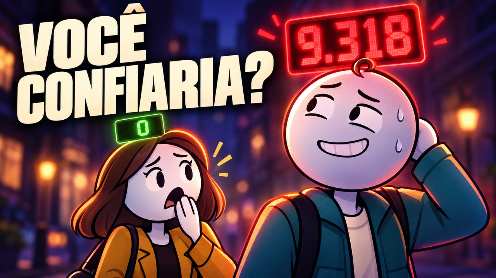

# 02 — Quantas mentiras / Então

Episódio completo de **8min20s**, produzido no aiTrends adaptado, com voz Puck, formato horizontal e exportação nativa 1920×1080/24 fps.

Título: **E se você pudesse ver quantas mentiras cada pessoa já contou?**

Texto da capa: **QUEM ESTÁ MENTINDO?**

- `titulo.txt`: título para copiar.
- `descricao.txt`: descrição com capítulos e CTA do Então.
- `tags.txt`: tags em uma linha, separadas por vírgulas.
- `metadata.json`: versão estruturada.
- `REFERENCIA-EDITORIAL.md`: análise da referência, anterior à adaptação própria.
- [Projeto, roteiro e exports](../../../AiTrends/projetos/02-quantas-mentiras/README.md).

A capa usa figuras simples, contraste e contadores luminosos inspirados nas referências enviadas, com composição própria e sem marcas dos canais de referência. É uma ilustração promocional gerada com IA, não um frame do filme. A história final tem conflito e narração próprios; não reutiliza a narração nem os frames do vídeo de referência.

Publicado apenas no GitHub. O upload para o canal do YouTube não foi executado.
