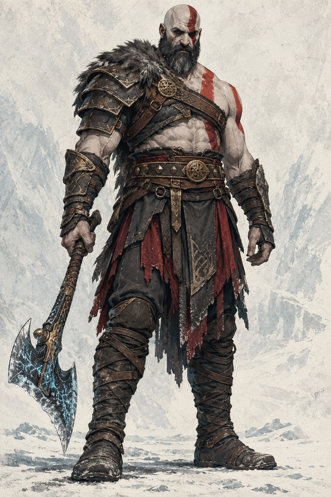
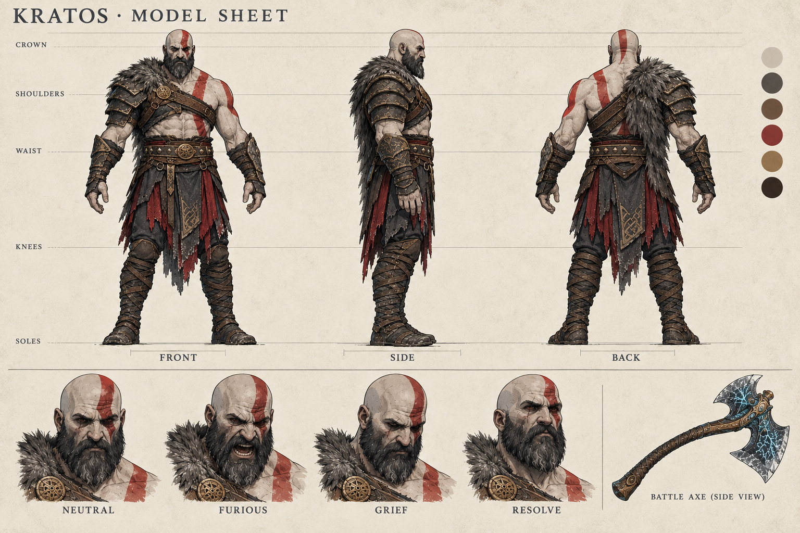

# RAGNAROK — desenvolvimento visual

Primeira entrega para uma adaptação animada de **God of War Ragnarök**, mantendo Kratos e a história do jogo, conforme solicitado. Direção visual: gravura nórdica pintada, couro e metal escuros, vermelho queimado e gelo ciano.

## Ver agora

- [Kratos — arte principal](imagens/personagens/kratos/kratos_conceito.png)
- [Kratos — model sheet: frente, perfil, costas e expressões](imagens/personagens/kratos/kratos_model_sheet.png)
- [Kratos — seis poses de ação](imagens/personagens/kratos/kratos_poses.png)
- [Armas e desenvolvimento de efeitos de gelo](imagens/assets/armas/armas_e_fx_conceito.png)
- [Cenário — Midgard no Fimbulwinter](imagens/cenarios/midgard/midgard_fimbulwinter.png)
- [Storyboard visual — teste de abertura, oito quadros](imagens/storyboards/abertura_fimbulwinter_01.png)
- [Voz provisória de Kratos em português](audios/vozes/kratos/kratos_teste_ptbr.mp3)
- [Efeito — machado e gelo](audios/efeitos_sonoros/machado_gelo.mp3)
- [Ambiente — vento em Midgard](audios/efeitos_sonoros/vento_midgard.mp3)





## Organização

```text
RAGNAROK/
  imagens/
    personagens/kratos/       conceito, model sheet e poses
    assets/armas/             prancha de armas e FX
    assets/itens/             reservado para objetos de cena
    cenarios/midgard/         cenário do Fimbulwinter
    efeitos/                 reservado para elementos VFX separados
    storyboards/             prancha visual da abertura
    animacoes/               reservado para sequências animadas
  audios/
    vozes/kratos/             fala de teste
    efeitos_sonoros/          machado/gelo e vento
    manifesto.json           modelos, voz e prompts utilizados
  documentacao/              direção visual, storyboard e planejamento
  scripts/                  cliente ElevenLabs sem credenciais no código
```

## O que esta entrega contém

Seis imagens novas e três áudios gerados para este projeto. Os desenhos são interpretações visuais novas; Kratos, os personagens e a história de God of War Ragnarök são preexistentes. A voz usa uma voz de catálogo da ElevenLabs: não é a voz oficial nem uma clonagem do ator. A fala é um texto de teste, não uma transcrição do jogo.

As pranchas são imagens achatadas de desenvolvimento visual. O model sheet não é um modelo 3D nem um rig. As poses são referências estáticas, não animações exportadas ou um ciclo de caminhada completo. A prancha de armas inclui estudos de FX; os elementos ainda não estão separados em transparência.

O storyboard desta entrega cobre somente um **teste de abertura de 30 segundos**. A animação completa, o storyboard do filme inteiro e os sheets dos demais personagens ainda não foram produzidos.

## Referência em vídeo

O arquivo enviado `YTDown.com_YouTube_Media_vLIx-ZLlReY_Animated-God-of-War-Ragnarok-Full-Movie_001_1080p.mp4` não pôde ser transferido: a ferramenta desta sessão retornou `file exceeds the executor transfer limit of 32 MiB`. Nenhum quadro ou áudio desse arquivo foi analisado. Para estudar sua montagem e linguagem com precisão, é necessária uma cópia de até 32 MiB ou partes abaixo desse limite.

- [Direção visual e continuidade](documentacao/DIRECAO_VISUAL.md)
- [Storyboard do teste de abertura](documentacao/STORYBOARD_ABERTURA.md)
- [Estrutura da adaptação e pendências](documentacao/PLANO_DE_PRODUCAO.md)
- [Inventário técnico e verificações](documentacao/manifesto_assets.json)

## Gerar mais áudio

Requer Python 3, acesso a `api.elevenlabs.io` e a variável segura `ELEVENLABS_API_KEY`. Não cole a chave no repositório. A geração utiliza os créditos da conta ElevenLabs.

Execute a partir da raiz do repositório, usando um ID de voz disponível na conta (o usado neste pacote está no manifesto de áudio):

```bash
python3 RAGNAROK/scripts/gerar_audio.py voz "Texto em português." RAGNAROK/audios/vozes/kratos/nova_fala.mp3 --voz ID_DA_VOZ
python3 RAGNAROK/scripts/gerar_audio.py efeito "Heavy ice crack, no music, no voices" RAGNAROK/audios/efeitos_sonoros/novo_gelo.mp3 --segundos 3
```

O script não sobrescreve arquivos existentes. Ele foi usado para gerar os três áudios desta entrega. Não há dependências Python externas.
